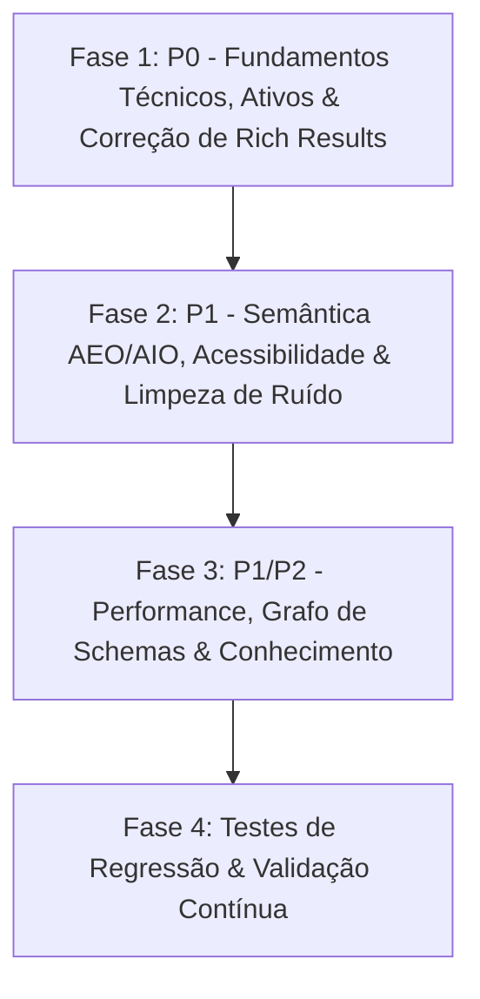

# Plano de Implementação: Otimização SEO & Engenharia Semântica (Omni Sistemas)

Documento baseado na auditoria da skill **Modern-SEO-Web-Architect** aplicada à landing page da **Omni Sistemas**.

---

## 1. Premissas e Decisões Consolidadas

1. **Escopo Geográfico:** Atuação nacional remota.
   - Padrão definido: `Organization` e `ProfessionalService` com `areaServed: "BR"`, sem restrições físicas de `LocalBusiness`.
2. **Canal de Contato Comercial:** WhatsApp oficial: **(41) 99241-5220** (`https://wa.me/5541992415220`).
   - Integrar no Header, Hero/Micro-CTAs, Footer e no bloco `contactPoint` do Schema.org.
3. **Métricas do Hero e Footer:**
   - Remoção de métricas arbitrárias sem comprovação (ex.: *SLA 99.998%*, *99,9% Stability*, *100% Conforme*).
   - Substituição por qualificadores técnicos de processo (ex.: *"Alinhado aos princípios do modelo de qualidade ISO/IEC 25010"*, *"Desenvolvimento Preventivo STE-DEV com Verificação Estática e Módulos < 100 linhas"*).
4. **Logo e Autoria dos Artigos:**
   - Criação de assets locais temporários (`/logo.png`, `favicon.ico`, `apple-touch-icon.png` e `og-image.png` contextualizada) para evitar erros 404 e garantir Rich Results válidos no Google, até que o logo oficial definitivo seja fornecido.
   - Definição do fundador **Ronaldo Domingues Filardo** como entidade `@type: "Person"` no campo `author` dos artigos, acompanhado de descrição e credenciais E-E-A-T.
5. **Redes Sociais (`sameAs`):**
   - Esvaziar URLs não confirmadas no schema (`sameAs: []`) até publicação oficial dos canais.

---

## 2. Visão Geral das Fases

---

## 3. Detalhamento das Fases

### Fase 1: P0 — Correções Críticas, Ativos e Sanidade de Rich Results
*Objetivo: Eliminar erros 404 de schema, gerar metadados visuais, remover links mortos e encurtar meta descriptions.*

1. **Ativos Visuais e de Marca (`public/`):**
   - Criar `/logo.png`, `favicon.ico` e `apple-touch-icon.png` locais.
   - Gerar arte de `og-image.png` (1200×630) com tipografia da marca e tagline da empresa.
2. **Configurações Globais (`src/config/site.ts`):**
   - Reduzir `SITE.description` para o limite seguro de visualização do Google (150–158 caracteres).
   - Adicionar o WhatsApp comercial `+55 41 99241-5220` e link oficial.
   - Definir `SITE.sameAs` como array vazio temporariamente.
   - Encurtar descrições e títulos longos dos artigos.
3. **Ordem de Carregamento dos Schemas (Critical-First):**
   - Mover a injeção do schema `buildFaqPageSchema` para o topo em `app/page.tsx` junto aos schemas principais (dentro dos primeiros 2% do HTML).
4. **Links Mortos e Hotlinks:**
   - Vincular a âncora `#sobre` à seção correspondente ou à seção do fundador.
   - Substituir imagens e logos de terceiros hospedados externamente por arquivos locais com dimensões explícitas (`width` e `height`).
5. **Acessibilidade do Formulário e Regiões Roláveis:**
   - Adicionar associação explícita `htmlFor` / `id` nos campos de formulário e rótulo acessível no `<select>`.
   - Adicionar `tabIndex={0}` e `aria-label` nas tabelas, blocos de código e carrosséis horizontais.

---

### Fase 2: P1 — Semântica, AEO/AIO, Acessibilidade e Limpeza de Ruído
*Objetivo: Blindar o código contra ruído na extração por LLMs, estruturar AEO (resumos de 40-50 palavras) e melhorar conversão (SXO).*

1. **Higienização de Ícones para Robôs de Busca:**
   - Inserir `aria-hidden="true"` e `translate="no"` em todos os spans de ícone (Material Symbols) para evitar leitura de strings como *"terminal"*, *"help_outline"* e *"summarize"*.
2. **AEO (Answer Engine Optimization) & Featured Snippets:**
   - Inserir tags `<h3>` semânticas dentro dos `
` das perguntas do FAQ.
   - Calibrar as respostas do FAQ para respostas diretas de 40 a 50 palavras.
   - Criar bloco de resposta direta no início da página definindo: *"O que é a metodologia STE-DEV?"* (40–50 palavras).
3. **AIO (AI Overview Optimization):**
   - Reestruturar o componente "Principais Pontos" como lista semântica pura (`<ul>` e `<li>`).
   - Remover a menção visível do termo `(AI Overview)` do título.
4. **Arquitetura de Headings (H1 e H2):**
   - Ajustar o H1 do Hero para explicitar a entidade e a disciplina:
     - Kicker: *"Engenharia de Software Preventiva"*
     - H1: *"Omni Sistemas: Desenvolvimento de Software Preventivo e Auditoria sem Refatoração"*
   - Converter H2s das seções principais em perguntas diretas baseadas em intenção de busca.
5. **CTAs e Conversão com WhatsApp (SXO):**
   - Distribuir micro-CTAs ao longo da rolagem da página.
   - Inserir botão de contato rápido via WhatsApp `(41) 99241-5220` com âncora de segurança (*"Atendimento técnico direto pelo arquiteto responsável"*).
   - Ajustar a tabela comparativa "STE-DEV × Desenvolvimento Tradicional" para leitura otimizada por robôs de IA.

---

### Fase 3: P1/P2 — Performance, Grafo de Schemas e Knowledge Files
*Objetivo: Adiar bundle de Three.js, unificar grafo de schema por `@id` e publicar a base de conhecimento.*

1. **Otimização de Performance e JavaScript Inicial:**
   - Adiar o carregamento da cena Three.js/R3F do Hero via `requestIdleCallback` ou interação do usuário.
   - Desativar a cena 3D em dispositivos móveis, mantendo layout estático ultra-leve.
2. **Grafo Unificado de Schemas (`src/lib/schemas.ts`):**
   - Conectar `Organization`, `WebSite`, `WebPage`, `ProfessionalService` e `Article` utilizando URIs `@id` canônicas.
   - Definir `author` dos artigos como `@type: "Person"` (Ronaldo Domingues Filardo) com vínculo `worksFor: Organization`.
   - Adicionar `areaServed: "BR"` nas ofertas de serviço.
3. **Publicação da Base de Conhecimento (Knowledge Files):**
   - Servir os arquivos de `content/conhecimento/` como documentação pública indexável em `/conhecimento/*`.
   - Consolidar o documento `knowledge-context.md` (Entity Profile, Q&A Estruturado e Sumário Semântico).
   - Atualizar `public/llms.txt` e `public/llms-full.txt` com as referências consolidadas.
4. **Diretivas de Crawlers (`robots.ts` e `sitemap.ts`):**
   - Incluir `Disallow: /api/` no arquivo `robots.ts` e mapear os principais user-agents de IA (GPTBot, ClaudeBot, PerplexityBot, etc.).
   - Utilizar datas reais de modificação dos arquivos no `sitemap.ts`.

---

### Fase 4: Testes de Regressão e Validação Contínua
*Objetivo: Garantir que nenhuma alteração futura degrade a pontuação de SEO.*

1. **Bateria de Testes de SEO (`src/test/seo.test.ts`):**
   - Validar sintaxe e integridade de todos os JSON-LDs.
   - Validar existência física de imagens apontadas nos metadados (`logo.png`, `og-image.png`, favicons).
   - Validar limites de caracteres de títulos (≤ 60) e descrições (≤ 160).
   - Garantir que todos os spans de ícone possuam `aria-hidden="true"`.
2. **Build e Testes Finais:**
   - Executar `pnpm test` e `pnpm build` para assegurar que o SSG continue 100% estático e sem erros.
